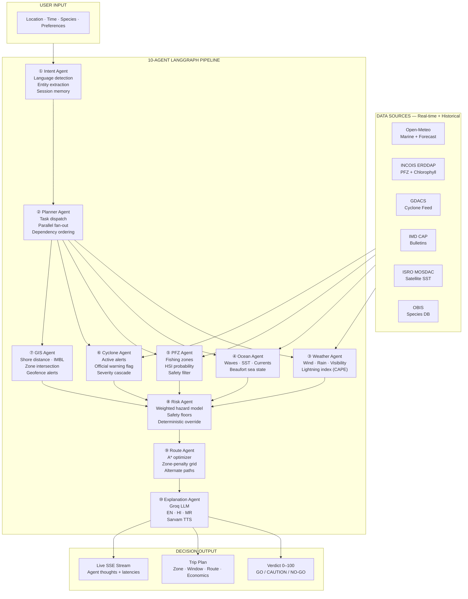
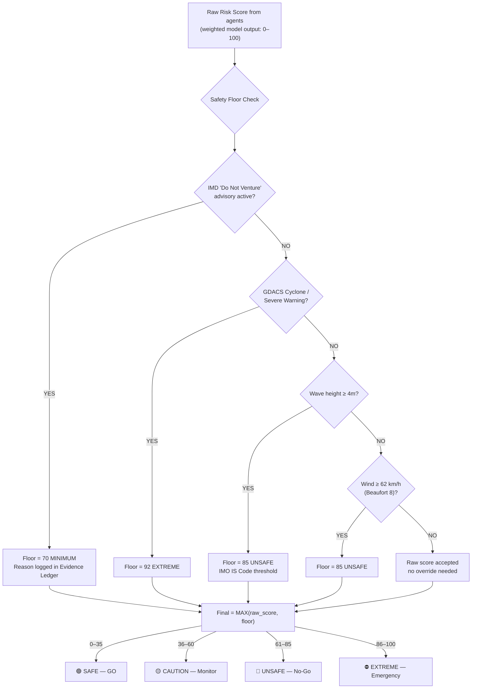
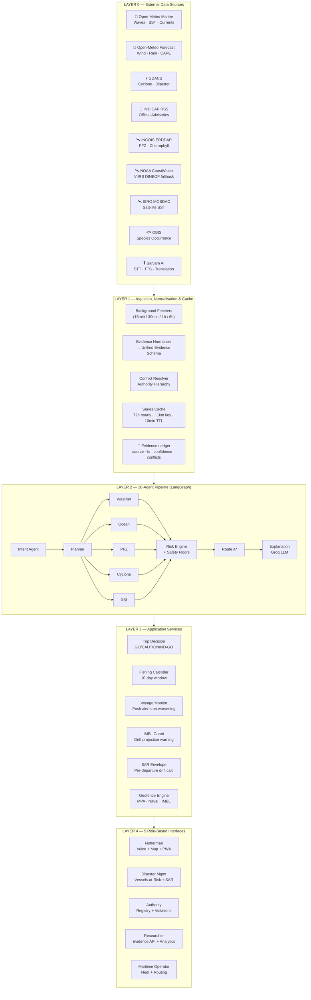

<div align="center">


# ORCA 2.0
### Marine EcOsystem Reasoning with Collaborative Agents

> *Ten specialized AI agents read the sea.*
> *One safe, explainable decision — in the fisher's own language.*

<br/>

[](https://sih.gov.in)
[](https://sih.gov.in)
[](https://github.com/akshatog/ORCA)
[](https://kiet.edu)

<br/>

[](https://python.org)
[](https://fastapi.tiangolo.com)
[](https://langchain-ai.github.io/langgraph)
[](https://react.dev)
[](https://docker.com)
[](https://github.com/akshatog/ORCA/actions)

<br/>

**[🌐 Live Demo](https://orca-marine.onrender.com)** &nbsp;·&nbsp; **[📹 Demo Video](#)** *(link coming soon)* &nbsp;·&nbsp; **[📖 API Docs](https://orca-marine.onrender.com/docs)**

</div>

---

## 📋 Problem Statement

**PS ID: SIH26176 &nbsp;·&nbsp; Theme: Space Technology &nbsp;·&nbsp; Category: Software &nbsp;·&nbsp; Organization: ISRO**

> *"Develop an intelligent conversational platform with collaborative agents to synthesise fragmented satellite and ocean data into actionable, evidence-based recommendations for fishermen, researchers, coastal authorities, disaster management agencies, and maritime operators."*

### The Problems — Documented & Quantified

| Problem | Evidence |
|---|---|
| **535 fishermen arrested** for inadvertently crossing IMBL in 2024 | ISRO, ICG reports — cause: ocean current drift, not intent |
| **INCOIS advisories reach 52% of fishers, only 35% use them** | INCOIS adoption study — advisories are chlorophyll maps in English |
| **~400–500 fishers die annually** on Indian coasts | Ministry of Fisheries — most deaths preventable with better information |
| **No unified decision layer** | ISRO, IMD, INCOIS data exists — but no system synthesises it into one answer |
| **2.3× catch improvement** possible with PFZ guidance — currently inaccessible | ICAR Goa Validation Study |
| **₹17,820 additional income** per PFZ-guided trip | INCOIS validation study |
| **28–30 million livelihoods** dependent on Indian fisheries | PIB, Ministry of Fisheries |

**Three core gaps ORCA addresses:**

1. **Fragmented Marine Intelligence** — ISRO, IMD, and INCOIS data existed but no system synthesised it into one decision
2. **Last-Mile Advisory Gap** — Chlorophyll maps are hard to read on small screens at 4 AM in a regional language
3. **No Unified Decision Layer** — No single system combines risk + fishing zones + routes + travel time into one clear answer

---

## 💡 Proposed Solution — ORCA

**ORCA — Agentic Marine Intelligence Platform**

ORCA synthesises fragmented marine data through **10 collaborative AI agents** to generate safe, explainable, and location-specific decisions — with evidence, safety overrides, and multilingual delivery.

```
                    USER INPUT
          ┌─────────────────────────────┐
          │  Location (GPS)             │
          │  Time / Duration            │
          │  Target Species             │
          │  Risk tolerance / Budget    │
          └──────────────┬──────────────┘
                         │
              ┌──────────▼──────────┐
              │   ORCA CORE ENGINE  │
              │  10 Collaborative   │
              │    AI Agents        │
              └──────────┬──────────┘
                         │
          ┌──────────────┼───────────────┐
          ▼              ▼               ▼
   Fisherman App    Web Platform    Alerts & Notifications
   GPS-based recs   Analytics       Hazard alerts
   GO/CAUTION/NO-GO Historical      Mass broadcast
   Voice (EN/HI/MR) Research tools  Cyclone warnings
   Offline-first    Policy insights  Multi-channel

                    DECISION OUTPUT
          ┌─────────────────────────────────┐
          │  Where to go  (safest/best zone)│
          │  When to go   (optimal window)  │
          │  How to go    (safest route)    │
          │  What to catch (target species) │
          │  Estimated cost & revenue       │
          │  Risk level   (0–100 + factors) │
          │  Why          (evidence trail)  │
          │  Confidence score               │
          └─────────────────────────────────┘
```

### 🏆 What Makes ORCA Different — Innovation & Uniqueness

| Innovation | Description |
|---|---|
| **Proactive, Not Reactive** | Pre-departure Drift/SAR Envelope + IMBL Current Guard identify potential drift and boundary-crossing risks *before* an emergency occurs |
| **Peer-Reviewed Fishing Intelligence** | Fishing zones computed using the Habitat Suitability Index methodology (Sarangi et al., CMFRI 2024) — the same method INCOIS uses, now voice-delivered in regional languages |
| **AI Never Controls Safety Math** | No model output, user input, or override can bypass certified safety floors. When IMD says "do not venture," ORCA locks at UNSAFE. Always. |
| **Evidence Transparency** | Every number carries its source, timestamp, and confidence tier — judges, fishers, and Coast Guard can trace any output |
| **5-Stakeholder Platform** | One backend, five role-based interfaces — fishers, researchers, authorities, disaster management, maritime operators |

---

## 🗃️ Multi-Source Data Fusion

ORCA ingests real-time + historical data from **9 sources** across 6 data categories:

| Category | Sources | Data Points |
|---|---|---|
| **Weather** | Open-Meteo Forecast | Wind, rainfall, temperature, cloud cover |
| **Ocean Conditions** | Open-Meteo Marine | Waves, tides, currents, SST |
| **PFZ & Fishing** | INCOIS ERDDAP | Fishing zones, chlorophyll, species distribution |
| **Cyclones & Warnings** | GDACS (15 min), IMD CAP | Track & forecast, storm alerts, severity |
| **Satellite Data** | ISRO MOSDAC, NOAA CoastWatch | SST imagery, ocean colour, anomaly detection |
| **Geospatial** | OpenStreetMap, built-in gazetteer | Bathymetry, marine boundaries, coastal infrastructure |
| **Historical** | OBIS / Map of Life | Past trends, seasonal patterns, species occurrence |

**3-Tier Fallback Cascade:** Official (INCOIS/IMD) → Open Equivalent (Open-Meteo/NOAA) → Cached → Demo Store.
Synthetic data is **never** silently presented as live — every response carries a `mode: LIVE/DEMO` badge.

---

## 🤖 The 10-Agent Architecture



### Agent Details

| # | Agent | Output | Key Logic |
|---|---|---|---|
| ① | **Intent** | Structured query: location, time, activity, language | Regex + optional LLM, session memory — zero hallucination on safety fields |
| ② | **Planner** | Execution DAG | LangGraph concurrent fan-out, dependency ordering |
| ③ | **Weather** | Wind, rain, visibility, lightning potential | Open-Meteo Forecast · CAPE-derived lightning index |
| ④ | **Ocean** | Waves, SST, currents, sea state, chlorophyll | Open-Meteo Marine · Beaufort scale |
| ⑤ | **PFZ** | Ranked fishing zones with probability | INCOIS → NOAA → Demo cascade · Safety filter removes restricted zones |
| ⑥ | **Cyclone** | Active alerts, official warning flag, severity | GDACS + IMD CAP priority cascade |
| ⑦ | **GIS** | Shore distance, IMBL distance, zone proximity | Built-in gazetteer · pure-Python ray-casting point-in-polygon |
| ⑧ | **Risk** | Score 0–100, category, factor breakdown | 3-layer: Normalise → Combine → Override (floors only raise, never lower) |
| ⑨ | **Route** | Recommended route + 2 alternatives, travel time | A* with risk-weighted edges, zone-penalty 50×50 grid |
| ⑩ | **Explanation** | Natural language in EN/HI/MR: WHAT/WHY/WHERE/WHEN/SOURCE | Template + Groq LLM rephrase + Sarvam TTS |

---

## ⚠️ Risk Engine — The Safety Core

Three layers, in strict order. **The system can ONLY raise risk scores, never lower them.**

### Layer 1 — Normalise
Piecewise-linear hazard curves → 0–1 factor per parameter. Calibrated for small motorised fishing craft (8–12m) per **IMO Intact Stability Code**:

| Hazard | Safe | Warning | Danger | Basis |
|---|---|---|---|---|
| Wave height | 0m → 0.00 | 1.5m → 0.45 | 4.0m → 1.00 | IS Code: small craft danger at 4m |
| Wind speed | 0 → 0.00 | 20km/h → 0.35 | 62km/h → 1.00 | Beaufort 8 gale = capsizing threshold |
| Visibility | 15km → 0.05 | 3km → 0.60 | 0km → 1.00 | Navigation hazard, distress detection |
| Offshore dist. | 0km → 0.05 | 25km → 0.38 | 100km → 0.90 | Rescue response time gradient |

### Layer 2 — Combine
Weighted sum → 0–100 composite score (weights from IMO IS Code capsizing factor hierarchy):

| Factor | Weight | Basis |
|---|---|---|
| Wave height | 0.25 | Primary capsize driver (IMO IS Code) |
| Official cyclone/advisory | 0.25 | Regulatory mandate — IMD warnings are law |
| Wind speed | 0.20 | Secondary capsizing amplifier |
| Rain/visibility | 0.10 | Navigation hazard |
| Sea state/currents | 0.10 | Hull stress, drift risk |
| GIS (distance, zones) | 0.10 | Rescue accessibility, legal compliance |

### Layer 3 — Deterministic Safety Floors

```yaml
# Inspectable, auditable, tunable without code changes
floors:
  severe_warning_floor:     92   # Cyclone/tsunami → EXTREME regardless of model output
  fishermen_warning_floor:  70   # IMD "do not venture" bulletin → minimum score
  wave_danger_floor:        85   # ≥ 4m waves → UNSAFE (IMO IS Code threshold)
  wind_danger_floor:        85   # ≥ 62 km/h gale → UNSAFE
  restricted_zone_floor:    60   # Inside restricted area → CAUTION minimum
  lightning_floor:          78   # Active lightning → HIGH minimum
```

**Score categories:** `0–35 SAFE` · `36–60 CAUTION` · `61–85 UNSAFE` · `86–100 EXTREME`

### Safety Floor Flow



---

## 🐟 Fishing Probability Model (HSI — Peer-Reviewed)

Based on **Habitat Suitability Index** methodology (Sarangi et al., CMFRI 2024) — the same approach INCOIS uses for official PFZ generation, now voice-delivered.

```
HSI = (SI_chl^0.30 × SI_sst^0.25 × SI_front^0.20 × SI_sea^0.15 × SI_time^0.10)
```

| Factor | Weight | Scientific Basis |
|---|---|---|
| Chlorophyll-a | 0.30 | Sarangi et al. 2024: strongest catch correlation — food proxy |
| SST band match | 0.25 | Thermal comfort — species-specific optimal range (27.96–29.47°C) |
| SST front detection | 0.20 | Convergence zones — bait aggregation hotspots |
| Sea state | 0.15 | Operational constraint — rough water scatters shoals |
| Time of day | 0.10 | Crepuscular feeding peaks (5–7 AM, 5–7 PM) |

---

## 🛡️ IMBL Current Guard

**535–560 Indian fishermen arrested in 2024 for crossing the IMBL — cause: ocean current drift, not intent.**

ORCA solves this geometrically:
1. GIS agent computes current distance to IMBL boundary polygon
2. Ocean agent provides current velocity + direction
3. If projection shows crossing within 2 hours → voice alert in fisher's language:
   *"Ocean current is carrying you toward international waters. Adjust course 15° North."*

This is a real, documented problem with a purely deterministic solution — no LLM involved.

---

## 👥 5-Stakeholder Platform

**Same backend. Same 10-agent pipeline. Same evidence ledger. Five role-based interfaces.**

| Stakeholder | Key Capabilities |
|---|---|
| **🎣 Fishermen** | GPS-based recommendations · Risk score GO/CAUTION/NO-GO · Best time + route · Species-specific fishing probability · Return-before risk guidance · IMBL drift alerts · Offline-first + multilingual voice |
| **🚨 Safety & Disaster Management** | Real-time hazard + cyclone alerts · Vessels-at-risk counter in projected cyclone path · Pre-computed SAR drift envelopes · Location-based mass alerts · Restricted-zone monitoring |
| **🔬 Researchers & Authorities** | Unified marine risk view · Evidence-backed marine intelligence · Historical trends + anomaly analysis · PFZ validation through catch reports · Vessel registry + geofence violation log · Custom data queries + visualisations |
| **🏛️ Coastal Authorities** | Automated 5nm violation log for enforcement · Monsoon ban compliance tracking · District-level risk dashboard · Policy and research insights |
| **🚢 Maritime Operators** | Port weather windows · Commercial routing (A* with cargo parameters) · Fleet tracking + ETA with weather delay · Multi-vessel management |

---

## 🏗️ Technical Architecture



---

## 🛠️ Tech Stack

| Layer | Technology | Notes |
|---|---|---|
| **Backend** | Python 3.10 · FastAPI · Pydantic v2 | Async, typed, 5 core dependencies |
| **Agent Orchestration** | LangGraph | Fan-out graph, wait-for-all semantics, streaming |
| **LLM** | Groq (Llama 3.3 70B) | <600ms inference, free tier |
| **Voice** | Sarvam AI (Saaras STT + Bulbul TTS) | Hindi, Marathi, English |
| **Marine Data** | Open-Meteo, INCOIS ERDDAP, NOAA CoastWatch | Government + open APIs |
| **Satellite** | ISRO MOSDAC, GDACS | SST, ocean colour, cyclone events |
| **Species Data** | OBIS / Map of Life | Species occurrence for HSI model |
| **Frontend** | React 18 · TypeScript · Vite | SSE-native, fast HMR |
| **Maps** | Leaflet.js | Nautical chart, wind/current particles |
| **Real-Time** | Server-Sent Events (SSE) | Live agent trace streaming |
| **GIS** | Pure-Python (ray-casting, A\*, haversine) | No external GIS library required |
| **PWA** | Service Worker · IndexedDB · Background Sync | Offline-first, installable |
| **Auth** | JWT + bcrypt | Role-based: fisher / researcher / authority / dm / operator |
| **Persistence** | SQLite | Voyage state survives server restarts |
| **Containerisation** | Docker + docker-compose | One-command setup |
| **Deployment** | Render | Auto-deploys on `main` push |
| **CI/CD** | GitHub Actions | pytest + npm build + /api/health on every push |

**No paid API keys required for the demo. No external database. No proprietary dependencies.**

---

## ✅ Feasibility & Viability

### Technical Feasibility

- Built on proven, widely available technologies (Python, FastAPI, React)
- Uses open and government data sources (IMD, INCOIS, Open-Meteo, GDACS, MOSDAC)
- 10-agent hybrid architecture — LLM for language, deterministic for safety
- Runs on standard devices (mobile PWA + web) with offline support
- Modular and extensible design for future expansion

### Data & Operational Feasibility

- Real-time + historical marine data from 9 verified sources
- Multiple dataset integration: waves, SST, chlorophyll, currents, tides, alerts
- Location-based analysis using GPS + coastal grids
- 10-day forecast calendar with tiered background data refresh
- Fallback mechanisms for data unavailability at every tier

### Strategies for Challenges

| Challenge | Strategy |
|---|---|
| Inconsistent marine datasets | Multi-source cascade + confidence scoring + transparent labelling |
| Connectivity at sea | PWA offline cache pre-loaded at port + VCSS satellite path |
| IMD/INCOIS data access | Use publicly available APIs; VCSS partnership post-selection |
| Forecast uncertainty | Deterministic safety floors override model uncertainty |
| GIS boundary accuracy | OSM + built-in 1974 IMBL coordinates + configurable alert distances |

---

## 🌍 Impact & Benefits

```
DATA → EVIDENCE → DECISION → SAFER OUTCOMES
```

### 🎣 For Fishermen
- Helps make safer, more informed decisions — reducing loss of life
- 2.3× higher catch per trip via PFZ guidance (ICAR validated)
- ₹17,820 additional income per guided trip
- Reduces fuel costs by 60–70% (less search time)
- Supports offline and multilingual access — bridges digital divide

### 🚨 For Coastal Communities & Disaster Management
- Real-time cyclone and hazard alerts with mass broadcast capability
- Vessels-at-risk counter overlaid on cyclone projected paths
- Pre-departure SAR drift envelopes — Coast Guard knows where to search before incidents
- Supports IMBL boundary monitoring to prevent illegal crossings

### 🔬 For Authorities & Researchers
- Unified marine evidence layer with traceable source + timestamp + confidence
- Automated 5nm violation logging for enforcement records
- PFZ Validation Module — compare catch reports vs ORCA predictions
- Historical trends + anomaly detection for policy and research

### 🌊 For the Blue Economy
- Improved fishing efficiency + resource sustainability
- Reduced operational costs across the fishing value chain
- Modular platform scalable to other coastal regions
- VCSS-ready — integrates with 49,000+ ISRO transponders already deployed

---

## 🔭 Future Roadmap

| Feature | Description |
|---|---|
| **NavIC/VCSS Integration** | ISRO's VCSS transponders (49,000 deployed, ₹364 crore PMMSY project) for at-sea satellite communication; ORCA registers as VCSS application provider |
| **Species-Specific HSI Models** | Separate models for pomfret (26–28°C), mackerel (22–27°C), tuna (28–30°C), hilsa (brackish) |
| **LoRa Mesh Network** | ₹800/vessel peer-to-peer relay — boats within 10–15 km form ad-hoc mesh for connectivity without infrastructure |
| **Marine Pollution Sentinel** | Detect oil spills, HABs, industrial thermal discharge from same satellite data via anomaly detection |
| **Predictive SAR** | Pre-position Coast Guard assets using historical distress patterns before incidents occur |
| **10-Day Fishing Calendar** | Same risk engine on full 10-day Open-Meteo forecast for weekly planning |
| **Marine Ecological Health Index** | Monthly overfishing detection, coral bleaching risk, mangrove cover monitoring |
| **Fish Market Intelligence** | Real-time FISHCOPFED prices + optimal landing port routing |

---

## 📚 Research & References

| Research Area | Paper | Relevance to ORCA |
|---|---|---|
| **PFZ Methodology** | Sarangi et al. (2024), CMFRI — *Environmental Monitoring and Assessment* | HSI weight hierarchy: Chl-a (0.30) as strongest predictor |
| **HSI Formula** | Zainuddin et al., *Frontiers in Marine Science* | Standard geometric mean formula ORCA implements |
| **SST Ranges** | Northern Indian Ocean fishing study (2024), PMC/NIH | Optimal SST: 27.96–29.47°C for Indian fishing operations |
| **Marine Risk** | IMO Intact Stability Code (IS Code) | Wave height as primary capsize driver, safety floor thresholds |
| **IMO Guidance** | MSC.1/Circ.1228 — avoiding dangerous weather | 4m wave + gale force wind danger thresholds |
| **ML Weather Prediction** | ML models for wave height, wind speed, cyclone prediction | Framework for coastal hazard alerts and risk communication |
| **PFZ Impact** | ICAR Goa Validation Study | 2.3× CPUE improvement, ₹17,820 additional income |
| **VCSS Deployment** | PIB (2024), PMMSY | 49,000+ transponders deployed, ₹364 crore project |
| **LoRa Maritime** | MDPI Sensors (2024) | Validates LoRa 10–15 km range for fishing fleet mesh |
| **Multi-Agent XAI** | MDPI (2025), *Journal of Marine Science and Engineering* | Deterministic core + XAI explanation layer — ORCA's architecture |
| **PFZ Adoption** | INCOIS Adoption Study | 52% receive advisories, 35% use — ORCA's adoption gap solution |
| **Ocean Data Integration** | Multi-source data fusion for marine decision systems | Basis for ORCA's evidence normalisation and conflict resolution |

---

## 🚀 Quick Start

### Option A — Docker (recommended — works on any OS, no setup required)

```bash
git clone https://github.com/akshatog/ORCA.git
cd ORCA
docker compose up --build
```

Open **http://localhost:8000** — done. ✅

> With LLM + voice features enabled:
> ```bash
> GROQ_API_KEY=gsk_... SARVAM_API_KEY=... docker compose up --build
> ```

### Option B — Local (Python 3.10 + Node 18+)

```bash
# Install backend dependencies
cd backend
pip install -r requirements.txt

# Build frontend
cd ../frontend
npm install
npm run build

# Start server
cd ../backend
ORCA_DATA_MODE=DEMO uvicorn app.main:app --port 8000
```

Open **http://localhost:8000**.

### Option C — Dev Mode (hot reload + Vite HMR)

```bash
# Terminal 1 — backend with auto-reload
cd backend
ORCA_DATA_MODE=DEMO uvicorn app.main:app --reload --port 8000

# Terminal 2 — Vite dev server (proxies /api → :8000)
cd frontend
npm run dev
```

Open **http://localhost:5173**.

### Makefile Commands

```bash
make help       # Show all available commands
make docker     # Build + run the full app in Docker
make run        # Local backend in DEMO mode (:8000)
make run-live   # Local backend in LIVE data mode
make dev        # Hot-reload backend + Vite HMR dev server
make test       # Run the full backend test suite (119 tests)
make build      # Build the frontend production bundle
```

### Environment Variables

| Variable | Default | Description |
|---|---|---|
| `ORCA_DATA_MODE` | `DEMO` | `DEMO` (rehearsed scenarios) or `LIVE` (real APIs) |
| `ORCA_USE_LLM` | `0` | `1` to enable Groq LLM explanation layer |
| `GROQ_API_KEY` | — | From [console.groq.com](https://console.groq.com) — free tier |
| `SARVAM_API_KEY` | — | From [sarvam.ai](https://sarvam.ai) — free tier |

---

## 🎬 Demo Deep Links

| URL | Scenario | What it shows |
|---|---|---|
| `/?tour=1` | Guided tour | Full feature walkthrough for judges |
| `/?demo=safe` | Goa | LOW risk 22/100, calm conditions, mackerel PFZ |
| `/?demo=danger` | Mumbai | HIGH risk, Marathi voice response, restricted zone |
| `/?demo=cyclone` | Paradip | EXTREME 92/100, cyclone override, SAR envelope |
| `/?demo=pfz` | Kochi | PFZ zones on map, Hindi TTS, INCOIS data |
| `/?demo=route` | Mumbai | A\* route planning + exclusion zone geofence |
| `/?tab=system` | System view | Live agent pipeline trace (for technical judges) |
| `/?m=1` | Mobile PWA | Fisherman mobile layout, voice-first |

---

## 🌐 Deployment

| | |
|---|---|
| **Web App (PWA)** | https://orca-marine.onrender.com |
| **API Documentation** | https://orca-marine.onrender.com/docs |
| **Health Check** | https://orca-marine.onrender.com/api/health |
| **Platform** | Render · Docker container · auto-deploys on `main` push |

> **Note:** The live deployment runs in DEMO mode (no API keys needed). For voice + LLM features, run locally with keys per setup instructions above.

---

## 📁 Repository Structure

```
ORCA/
├── .github/workflows/ci.yml     # CI: pytest + npm build + /api/health check
├── Dockerfile                    # Multi-stage: Node frontend build → Python serve
├── docker-compose.yml            # Production + dev profiles
├── Makefile                      # Cross-platform convenience commands
├── render.yaml                   # Render.com deployment config
│
├── backend/
│   ├── app/
│   │   ├── agents/               # 10 LangGraph agents
│   │   │   ├── intent_agent.py, planner.py, weather_agent.py
│   │   │   ├── ocean_agent.py, pfz_agent.py, cyclone_agent.py
│   │   │   ├── gis_agent.py, risk_agent.py, route_agent.py
│   │   │   └── explanation_agent.py
│   │   ├── api/                  # FastAPI routers
│   │   │   ├── chat_stream.py    # SSE streaming endpoint
│   │   │   ├── fishing.py, forecast.py, map.py, alerts.py
│   │   │   └── routes.py, voyages.py, voice.py, plan.py
│   │   ├── data/                 # Data layer
│   │   │   ├── live_client.py    # Open-Meteo 72h series cache
│   │   │   ├── incois_erddap.py  # INCOIS ERDDAP connector
│   │   │   ├── advisory_scraper.py  # IMD CAP + INCOIS scraper
│   │   │   ├── demo_store.py     # Rehearsed demo scenarios
│   │   │   └── scheduler.py      # Background refresh + keep-alive
│   │   ├── graph/                # LangGraph state graph
│   │   │   ├── graph.py, nodes.py, state.py
│   │   ├── services/             # Core logic
│   │   │   ├── conflict_resolver.py  # Authority hierarchy
│   │   │   ├── alert_engine.py, fishing.py
│   │   │   └── plain_language.py, i18n.py, llm.py
│   │   ├── config.py             # All weights, thresholds, overrides
│   │   └── main.py               # FastAPI entry point + SPA serving
│   ├── tests/                    # 119 unit + integration tests
│   └── requirements.txt
│
├── frontend/
│   ├── src/
│   │   ├── components/           # 27 React components
│   │   └── App.tsx               # SSE stream state manager
│   ├── public/                   # PWA assets (manifest, icons, sw.js)
│   └── dist/                     # Pre-built bundle (committed for Render)
│
└── docs/                         # Technical reference (architecture, API, schemas)
```

---

## 👥 Team Marines

<div align="center">

**Team ID: 175766 &nbsp;·&nbsp; Smart India Hackathon 2026 &nbsp;·&nbsp; PS SIH26176 — ISRO (Space Technology)**

**KIET Deemed to be University, Ghaziabad**

</div>

| Member | Role | Contribution |
|---|---|---|
| **Nitish Sablok** | Team Leader | Strategy, project coordination, presentation & pitch deck |
| **Akshat Agarwal** | Backend & AI Lead | LangGraph agent pipeline, INCOIS/NOAA integrations, backend architecture |
| **Tanya Vaish** | Frontend & UI/UX Lead | React components, design system, PWA, mobile layout |
| **Samveg Jain** | Product & Demo Lead | Product vision, use-case design, demo flow, stakeholder communication |
| **Muskan Singh** | Research & Documentation | Marine domain research, data source analysis, literature review, documentation |
| **Deepak** | QA & DevOps | Test suite (119 tests), CI/CD pipeline, Docker setup, deployment |

---

## ⚠️ Safety Disclaimer

ORCA is **decision support software** built for Smart India Hackathon 2026. It does **not** replace official advisories from:

- **INCOIS** — National Centre for Ocean Information Services
- **IMD** — India Meteorological Department
- **Indian Coast Guard**

This notice appears on every ORCA screen. When in doubt, always follow official government advisories.

---

<div align="center">

*Safer Fishermen &nbsp;·&nbsp; Cleaner Oceans &nbsp;·&nbsp; Stronger Coastal Communities*

<br/>

*Smart India Hackathon 2026 &nbsp;·&nbsp; Problem Statement SIH26176 &nbsp;·&nbsp; ISRO — Space Technology*

*KIET Deemed to be University, Ghaziabad &nbsp;·&nbsp; Team MARINES #175766*

</div>
