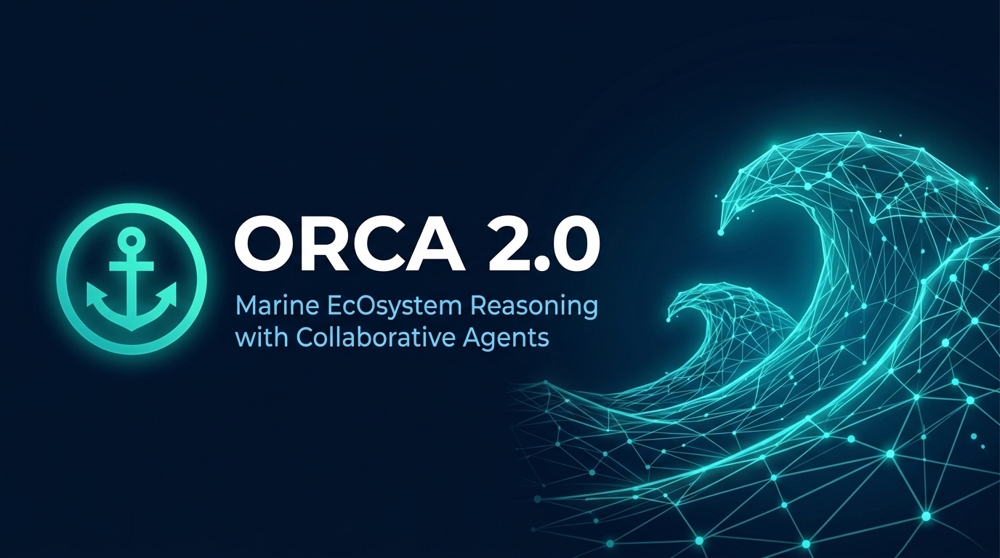
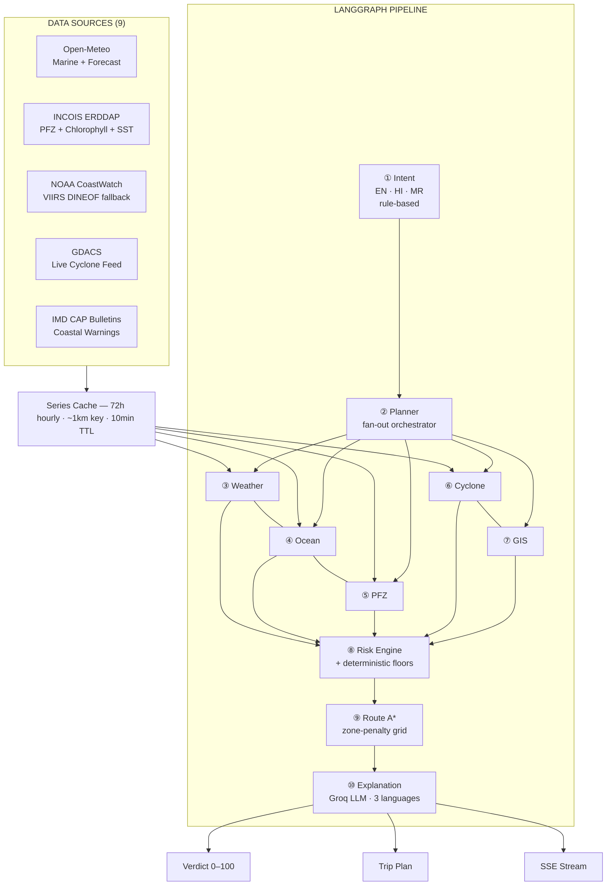
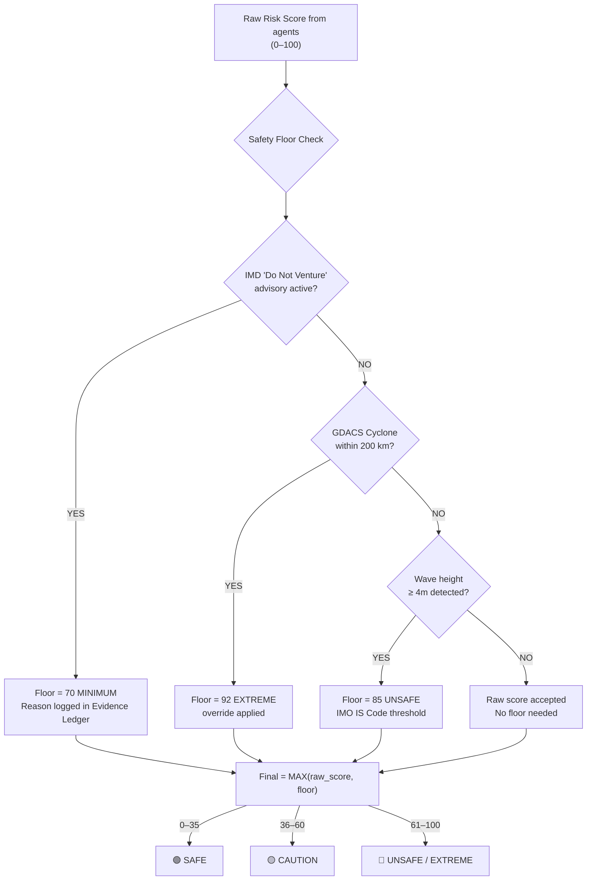

<div align="center">



# ORCA 2.0
### Marine EcOsystem Reasoning with Collaborative Agents

**Ten specialized AI agents read the sea. One safe, explainable decision — in the fisher's own language.**

<br/>

[](https://sih.gov.in)
[](https://sih.gov.in)
[](https://github.com/akshatog/ORCA)
[](https://kiet.edu)

<br/>

[](https://python.org)
[](https://fastapi.tiangolo.com)
[](https://langchain-ai.github.io/langgraph)
[](https://react.dev)
[](https://github.com/akshatog/ORCA/actions)

<br/>

**🌐 [Live Demo](https://orca-marine.onrender.com)** &nbsp;|&nbsp; **📹 Demo Video** *(link coming soon)* &nbsp;|&nbsp; **📖 [API Docs](https://orca-marine.onrender.com/docs)**

</div>

---

## 🎙️ The Pitch

> *"535 Indian fishermen were arrested last year for accidentally crossing a line they could not see. The satellite data to prevent every single one of those arrests already exists. ORCA makes it accessible."*

---

## 🌊 The Problem

Every year, thousands of Indian fishers venture into the Arabian Sea and Bay of Bengal with fragmented information and no integrated decision support. The consequences are severe and documented:

| Problem | Scale | Source |
|---|---|---|
| Fishermen arrested for IMBL crossing | 535–560 in 2024 alone | CMFRI / ICG reports |
| PFZ advisory adoption gap | 52% receive, only 35% use | INCOIS adoption study |
| Primary cause of IMBL crossing | Inadvertent drift due to ocean currents | ICG/fisheries reports |
| Income lost per fisher (monsoon ban) | ₹10,000–₹20,000 for 61 days | PMMSY/state govt data |
| CPUE improvement from PFZ guidance | 2.3× higher catch per trip | ICAR Goa validation study |
| Additional income per PFZ-guided trip | ₹17,820 average | INCOIS validation study |
| Fuel saving from PFZ guidance | 60–70% reduction in search time | INCOIS/CMFRI |
| Active marine fishers in India | ~1 million | IOTC / Marine Fisheries Census |
| Livelihoods dependent on fisheries | 28–30 million | PIB, Ministry of Fisheries |

**The core insight:** All the data exists. INCOIS has PFZ. IMD has weather. ISRO has VCSS. The gap is the last mile — making that data actionable, voice-accessible, and trustworthy for a fisherman who cannot read a chlorophyll map.

---

## 🎯 PS Alignment — SIH26176 (ISRO)

> *"Develop an intelligent conversational platform with collaborative agents to synthesise fragmented satellite and ocean data into actionable, evidence-based recommendations for fishermen, researchers, coastal authorities, disaster management agencies, and maritime operators."*

| PS Requirement | ORCA Implementation |
|---|---|
| Conversational platform | Voice + text chat in EN / HI / MR |
| Collaborative agents | 10-agent hybrid (2 LLM + 7 deterministic + 1 orchestrator) |
| Synthesise fragmented data | 9 sources → Evidence Normaliser → unified Evidence schema |
| Evidence-based recommendations | Evidence Ledger: source + timestamp + confidence on every output |
| Fishermen | Trip decision, PFZ, route, voyage monitoring, voice, offline PWA |
| Researchers | Evidence API, PFZ validation module, anomaly subscriptions |
| Coastal authorities | Vessel registry, 5nm violation log, monsoon ban compliance |
| Disaster management | Vessels-at-risk counter, SAR pre-positioning, mass alert broadcast |
| Maritime operators | Port weather windows, commercial routing, fleet tracking |

---

## 💡 Proposed Solution

ORCA is **not a chatbot**. It is a crew of ten cooperating AI agents orchestrated by LangGraph that transforms India's fragmented marine data into a single, safe, explainable decision — spoken in the fisher's own language.

```
Fisher: "Kal jaana safe hai?" (Hindi voice)
                    │
     [Intent Agent] Parses: location, time, language — no LLM, no hallucination
                    │
         ─── parallel fan-out ───
   [Weather] [Ocean] [PFZ]  [Cyclone] [GIS]
   Open-Meteo  Waves INCOIS   GDACS  Boundaries
         ─── all complete, results verified ───
                    │
            [Risk Engine]  ← Safety floors: can ONLY raise, never lower
                    │
             [Route A*]   ← Safest path, not shortest
                    │
          [Explanation]   ← Groq LLM → plain language, 3 languages
                    │
    "Kal jaana safe hai. 18 km south-west mein mackerel
     milne ka chance 76% hai. Risk: 34/100. Yeh raha route."
```

**Every number carries its source, timestamp, and confidence tier. Official IMD/INCOIS warnings override everything — the system can only raise risk scores, never lower them past a safety floor.**

### Why existing tools aren't enough

| Capability | SAMUDRA | Fisher Friend | Nabhmitra | Windy | **ORCA** |
|---|---|---|---|---|---|
| Conversational NL query | ❌ | ❌ | ❌ | ❌ | ✅ |
| Voice input/output (EN/HI/MR) | ❌ | ❌ | ❌ | ❌ | ✅ |
| Go/No-Go risk verdict (0–100) | ❌ | ❌ | ❌ | ❌ | ✅ |
| A\* route planning | ❌ | Basic GPS | ❌ | ❌ | ✅ Risk-weighted |
| Evidence trail per output | ❌ | ❌ | ❌ | ❌ | ✅ |
| Multi-source conflict resolution | ❌ | ❌ | ❌ | ❌ | ✅ |
| Offline-first (cached at departure) | ❌ | ❌ | ❌ | ❌ | ✅ |
| 5-stakeholder interfaces | Fisher only | Fisher only | Fisher only | Sailors | ✅ |
| Live agent trace (SSE) | ❌ | ❌ | ❌ | ❌ | ✅ |

---

## ✨ Key Features

### 🤖 1. LangGraph Multi-Agent Pipeline
Ten specialized agents in a LangGraph state graph execute concurrently. The Risk Engine strictly waits for all upstream agents — no component skips the safety gate. Every agent's latency is streamed live via SSE.

### 📡 2. Real-Time Data Fusion (3-Tier Cascade)
| Tier | Source | Purpose |
|---|---|---|
| **Official** | INCOIS PFZ advisories (ERDDAP) | Potential Fishing Zones |
| **Satellite-enriched** | NOAA CoastWatch VIIRS DINEOF | Chlorophyll gap-fill when INCOIS is down |
| **Open** | Open-Meteo Marine + Forecast | Wave, wind, SST, rain (72h cache per km) |
| **Cyclone** | GDACS live feed (15 min polling) | Real-time storm tracking in Indian Ocean |
| **Advisory** | IMD CAP bulletins (1 hr scrape) | Active coastal warnings |

When any source fails, ORCA degrades transparently — the data badge updates. Synthetic data is **never** silently presented as live.

### 🗣️ 3. Native Voice in 3 Languages (Sarvam AI)
Fishers speak in Hindi or Marathi; ORCA responds in the same language. Browser captures `audio/webm`, converts to `WAV 16kHz PCM` via Web Audio API, streams to Sarvam AI Saaras (STT) and Bulbul (TTS). No audio uploaded to an external server — all processing is client-side before STT.

### 📺 4. Live Agent Trace (SSE Streaming)
Server-Sent Events stream each agent's status, data, latency, and reasoning to the UI as the pipeline executes. Judges and researchers can watch the system think in real time.

### 🗺️ 5. Safety-Aware Route Planning (A\*)
A\* with risk-weighted zone penalties avoids defence exclusion zones, marine protected areas, and high-risk weather corridors. Safety-first, not distance-first. Results shown on live nautical chart.

### ⚠️ 6. Risk Engine — The Safety Core

Three layers, in strict order:

**Layer 1 — Normalise:** Piecewise-linear hazard curves → 0–1 per parameter, calibrated for small motorised fishing craft (8–12m) per IMO Intact Stability Code.

| Hazard | Curve Breakpoints | Basis |
|---|---|---|
| Wave height | 0m→0.00, 1.5m→0.45, 2.5m→0.87, 4.0m→1.00 | IS Code: danger at 4m |
| Wind speed | 0→0.00, 20km/h→0.35, 35km/h→0.77, 62km/h→1.00 | Beaufort 8 = capsizing threshold |
| Visibility | 0km→1.00, 3km→0.60, 15km→0.05 | Navigation hazard |

**Layer 2 — Combine:** Weighted sum → 0–100 composite score (wave 0.25, official advisory 0.25, wind 0.20, rain/vis 0.10, currents 0.10, GIS 0.10).

**Layer 3 — Override:** Deterministic safety floors. No LLM, no model, no user input can lower a score past a floor.

```yaml
floors:
  severe_warning_floor:    92   # cyclone/tsunami → EXTREME regardless
  fishermen_warning_floor: 70   # "do not venture" bulletin → minimum
  wave_danger_floor:       85   # ≥ 4m waves → UNSAFE
  wind_danger_floor:       85   # ≥ 62 km/h gale → UNSAFE
  lightning_floor:         78   # active lightning
```

Categories: `0–35 SAFE` · `36–60 CAUTION` · `61–85 UNSAFE` · `86–100 EXTREME`

### 🐟 7. Fishing Probability Model (HSI — Peer-Reviewed)

Based on Habitat Suitability Index methodology (Sarangi et al., 2024, CMFRI):

```
HSI = (SI_chl^0.30 × SI_sst^0.25 × SI_front^0.20 × SI_sea^0.15 × SI_time^0.10)
```

Validated ranges: Chl-a 0.03–1.81 mg/m³, SST 27.96–29.47°C (Northern Indian Ocean fishing study, PMC/NIH, 2024). Crepuscular time-of-day bonus at 5–7 AM and 5–7 PM — documented in fisheries literature.

### 🛡️ 8. IMBL Current Guard
535–560 Indian fishermen arrested in 2024 for crossing the IMBL — cause is ocean current drift, not intent. ORCA solves this geometrically: if current velocity + heading project a crossing within 2 hours → voice alert in fisher's language.

### 📊 9. Authority & District Dashboard
All Indian fishing ports scored on one board, real-time risk breakdown, CSV export, conflict resolution log with full authority hierarchy.

### 📱 10. Progressive Web App (PWA)
Installable on Android/iOS from the same URL. Service worker caches trip intelligence before departure. Offline GPS continues working; positions queue to IndexedDB and sync on reconnect.

---

## 🏗️ Architecture



### Safety Floor Logic



---

## 👥 5-Stakeholder Platform

Same backend. Same 10-agent pipeline. Same evidence ledger. Five role-based interfaces:

| Stakeholder | Interface | Key Capabilities |
|---|---|---|
| **Fisher** | Voice + Map + PWA | Trip decision, PFZ map, safe route, voyage monitoring, offline cache |
| **Researcher** | Analytics Dashboard | Evidence API, PFZ validation, catch correlation, anomaly alerts |
| **Coastal Authority** | Governance Dashboard | Vessel registry, 5nm violation log, monsoon ban compliance |
| **Disaster Management** | Situational Awareness | Vessels-at-risk counter, mass alert broadcast, SAR pre-positioning map |
| **Maritime Operator** | Fleet Operations | Port weather windows, commercial routing, multi-vessel tracking |

---

## 🛠️ Tech Stack

| Layer | Technology | Notes |
|---|---|---|
| Backend | Python 3.10 · FastAPI · Pydantic v2 | Async, typed, 5 core dependencies |
| Agent Orchestration | LangGraph | Fan-out graph, wait-for-all semantics |
| LLM | Groq (Llama 3.3 70B) | <600ms, free tier |
| Voice | Sarvam AI (Saaras STT + Bulbul TTS) | Indian languages |
| Marine Data | Open-Meteo, INCOIS ERDDAP, NOAA CoastWatch | Government + open APIs |
| Cyclone | GDACS live feed | Indian Ocean events, 15 min |
| Frontend | React 18 · TypeScript · Vite | SSE-native, fast HMR |
| Maps | Leaflet.js | Nautical chart, wind/current particles |
| Real-Time | Server-Sent Events | Zero-overhead agent trace streaming |
| PWA | Service Worker + Web Manifest | Installable, offline-capable |
| GIS | Pure-Python (ray-casting, A\*, haversine) | No shapely/GEOS install required |
| Containerisation | Docker + docker-compose | One-command reproducible setup |
| Deployment | Render | Auto-deploys from GitHub push |
| CI/CD | GitHub Actions | pytest + npm build + /api/health check |

**No paid API keys required for the demo. No external database. No proprietary dependencies.**

---

## 🚀 Quick Start

### Option A — Docker (recommended, works on any OS)

```bash
git clone https://github.com/akshatog/ORCA.git && cd ORCA
docker compose up --build
```

Open **http://localhost:8000** — that's it.

> With LLM + voice features:
> ```bash
> GROQ_API_KEY=gsk_... SARVAM_API_KEY=... docker compose up --build
> ```

### Option B — Local (Python + Node)

```bash
cd backend && pip install -r requirements.txt
cd ../frontend && npm install && npm run build
cd ../backend && ORCA_DATA_MODE=DEMO uvicorn app.main:app --port 8000
```

### Option C — Dev Mode (hot reload + HMR)

```bash
# Terminal 1 — backend with auto-reload
cd backend && ORCA_DATA_MODE=DEMO uvicorn app.main:app --reload --port 8000

# Terminal 2 — Vite (proxies /api to :8000)
cd frontend && npm run dev
```

### Makefile Commands

```bash
make help       # List all commands
make docker     # Build and run in Docker
make run        # Local backend, DEMO mode (:8000)
make run-live   # Local backend, LIVE data
make dev        # Hot-reload backend + Vite HMR
make test       # Run 119 backend tests
make build      # Build frontend bundle
```

### Environment Variables

| Variable | Default | Description |
|---|---|---|
| `ORCA_DATA_MODE` | `DEMO` | `DEMO` (rehearsed) or `LIVE` (real APIs) |
| `ORCA_USE_LLM` | `0` | `1` to enable Groq LLM explanations |
| `GROQ_API_KEY` | — | [console.groq.com](https://console.groq.com) — free |
| `SARVAM_API_KEY` | — | [sarvam.ai](https://sarvam.ai) — free tier |

---

## 🎬 Demo Deep Links

| URL | Scenario |
|---|---|
| `/?tour=1` | Guided feature walkthrough |
| `/?demo=safe` | Goa — LOW risk, calm conditions |
| `/?demo=danger` | Mumbai — HIGH risk, Marathi voice response |
| `/?demo=cyclone` | Paradip — EXTREME 92/100 cyclone override |
| `/?demo=pfz` | Kochi — PFZ zones, Hindi TTS |
| `/?demo=route` | Mumbai — A\* route + exclusion zone geofence |
| `/?tab=system` | Live agent pipeline view (for technical judges) |
| `/?m=1` | Mobile PWA layout |

---

## 🔭 Future Roadmap (Post-Selection)

1. **NavIC/VCSS Integration** — ISRO's VCSS transponders (49,000 deployed, ₹364 crore project) for at-sea satellite communication beyond cellular range; ORCA registers as a VCSS application provider
2. **Species-Specific Fishing Zones** — Separate HSI models for pomfret, mackerel, tuna, hilsa
3. **LoRa Mesh Network** — ₹800/vessel peer-to-peer relay for fleet connectivity without infrastructure
4. **Marine Pollution Sentinel** — Detect oil spills, HABs, and thermal discharge from same satellite data
5. **Predictive SAR** — Pre-position Coast Guard assets before incidents using historical distress patterns
6. **10-Day Fishing Calendar** — Same risk engine on 10-day Open-Meteo forecast for weekly planning
7. **Marine Ecological Health Index** — Monthly productivity trend and overfishing detection per zone

---

## 📚 Research Grounding

All major design decisions are grounded in published academic literature:

| Claim | Reference |
|---|---|
| Chl-a = strongest catch predictor (HSI weight 0.30) | Sarangi et al. (2024), CMFRI — *Environmental Monitoring and Assessment* |
| Standard HSI geometric mean formula | Zainuddin et al., *Frontiers in Marine Science* |
| Optimal SST range 27.96–29.47°C for Indian fishing | Northern Indian Ocean fishing study (2024), PMC/NIH |
| Wave height = primary capsize driver for small craft | IMO Intact Stability Code (IS Code) |
| 2.3× CPUE improvement from PFZ guidance | ICAR Goa Validation Study |
| 535 IMBL arrests in 2024 from current drift | CMFRI / ICG reports |
| 49,000 VCSS transponders deployed | PIB (2024), PMMSY |
| LoRa 10–15 km range for maritime mesh | LoRa maritime studies (2024), MDPI Sensors |
| Deterministic safety core + LLM explanation layer | MDPI (2025), *Journal of Marine Science and Engineering* |

---

## 🌐 Deployment

| | |
|---|---|
| **Web App** | https://orca-marine.onrender.com |
| **API Docs** | https://orca-marine.onrender.com/docs |
| **Health Check** | https://orca-marine.onrender.com/api/health |
| **Platform** | Render · Docker container · auto-deploys on `main` push |

---

## 📁 Repository Structure

```
ORCA/
├── .github/workflows/ci.yml  # CI: pytest + npm build + health check
├── Dockerfile                 # Multi-stage: Node build → Python serve
├── docker-compose.yml         # Local dev + production profiles
├── Makefile                   # Convenience commands
├── render.yaml                # Render deployment config
├── backend/
│   ├── app/
│   │   ├── agents/            # 10 LangGraph agents
│   │   ├── api/               # FastAPI routers
│   │   ├── data/              # Data layer (live_client, scheduler, scrapers)
│   │   ├── graph/             # LangGraph state graph
│   │   ├── services/          # Risk engine, route optimizer, conflict resolver
│   │   ├── config.py          # All weights, thresholds, overrides
│   │   └── main.py            # FastAPI entry point + SPA serving
│   ├── tests/                 # 119 unit + integration tests
│   └── requirements.txt
├── frontend/
│   ├── src/components/        # 27 React components
│   ├── src/App.tsx            # SSE stream state manager
│   ├── public/                # PWA assets (manifest, sw.js, icons)
│   └── dist/                  # Pre-built bundle (committed for Render)
└── docs/                      # Technical reference docs (architecture, API)
```

---

## 👥 Team Marines

**Team ID: 175766 · Smart India Hackathon 2026 · PS SIH26176 — ISRO**
**KIET Deemed to be University, Ghaziabad**

| Member | Role | Contribution |
|---|---|---|
| **Nitish Sablok** | Team Leader | Strategy, project coordination, presentation & pitch deck |
| **Akshat Agarwal** | Backend & AI Lead | LangGraph pipeline, INCOIS/NOAA integrations, backend architecture |
| **Tanya Vaish** | Frontend & UI/UX Lead | React components, design system, PWA, mobile layout |
| **Samveg Jain** | Product & Demo Lead | Product vision, use-case design, demo flow, stakeholder communication |
| **Muskan Singh** | Research & Documentation | Marine domain research, data source analysis, technical documentation |
| **Deepak** | QA & DevOps | Test suite, CI/CD pipeline, Docker setup, deployment reliability |

---

## ⚠️ Safety Disclaimer

ORCA is **decision support software** built for the Smart India Hackathon 2026. It does **not** replace official advisories from INCOIS, IMD, or the Indian Coast Guard. This notice appears on every ORCA screen.

---

<div align="center">
<i>Smart India Hackathon 2026 &nbsp;·&nbsp; Problem Statement SIH26176 &nbsp;·&nbsp; ISRO<br/>
KIET Deemed to be University, Ghaziabad &nbsp;·&nbsp; Team Marines #175766</i>
</div>
