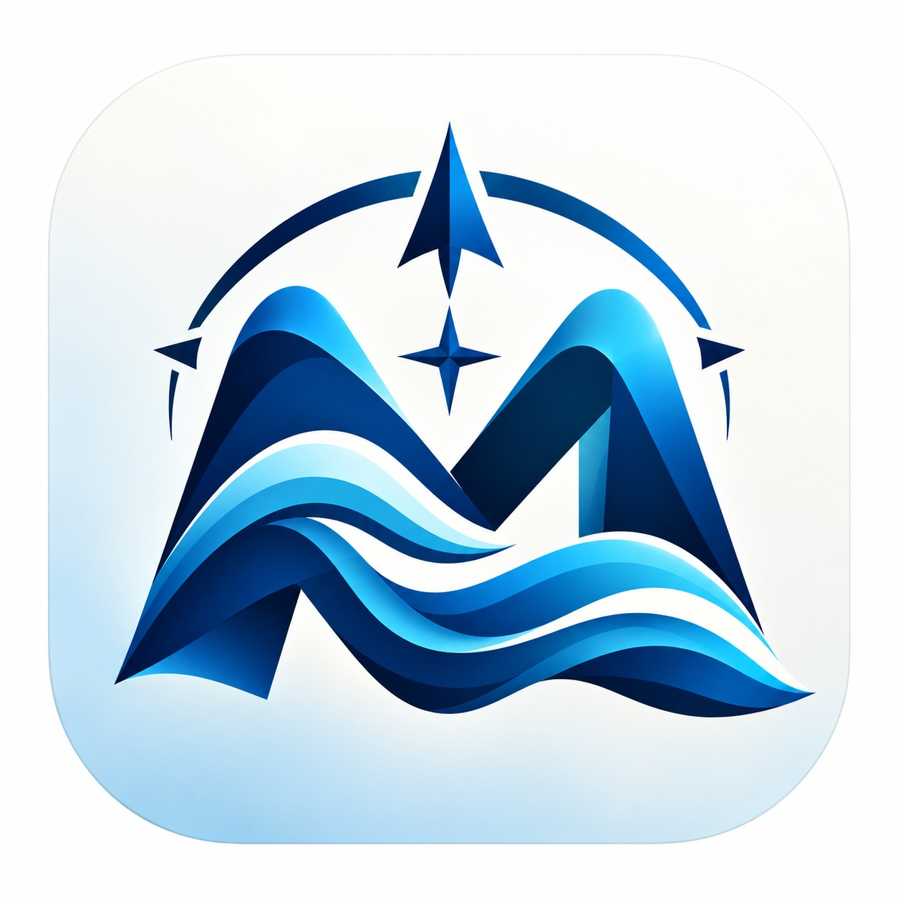
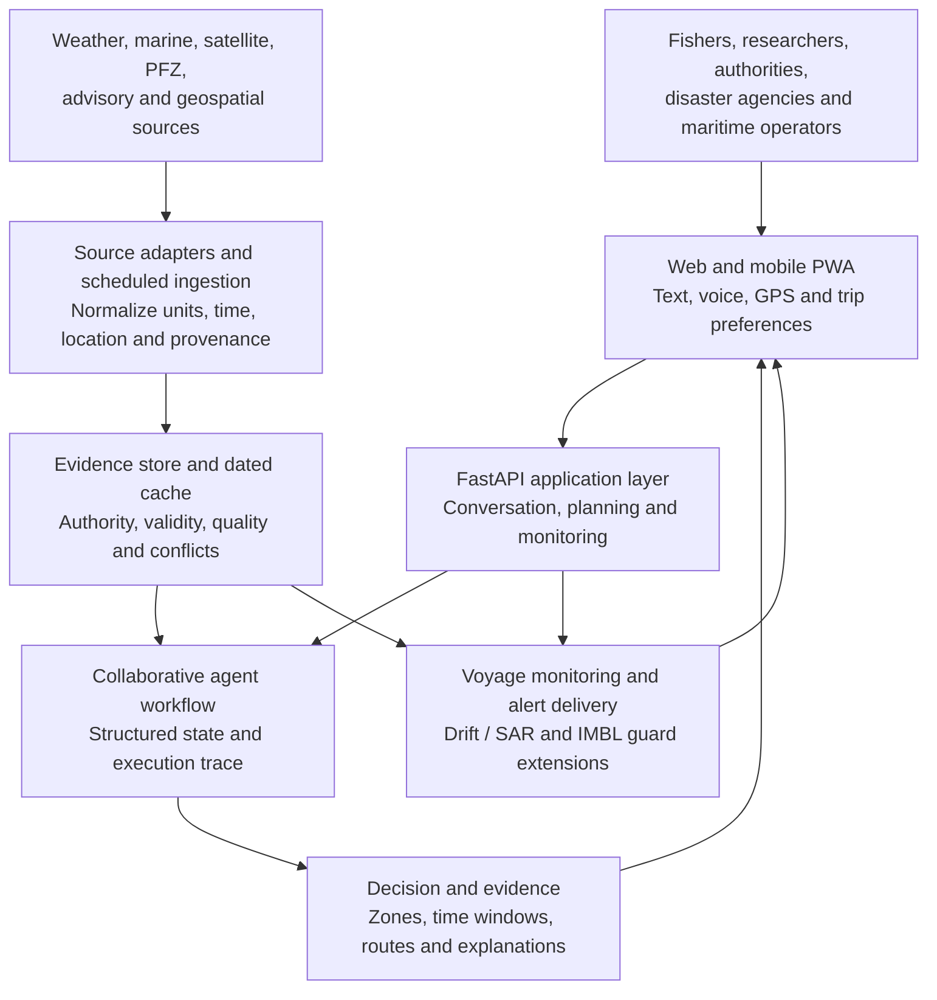
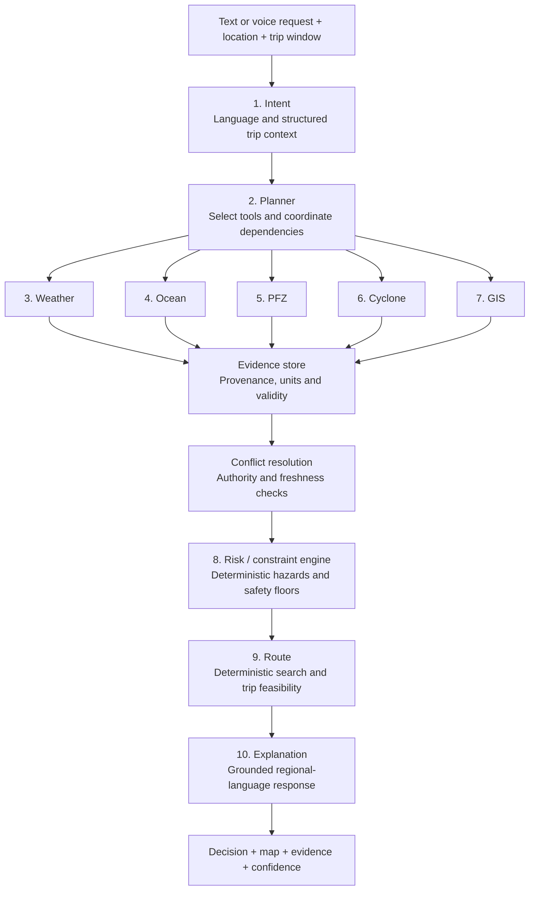
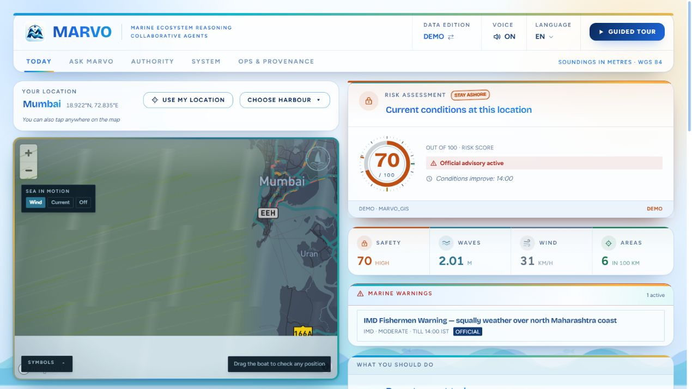
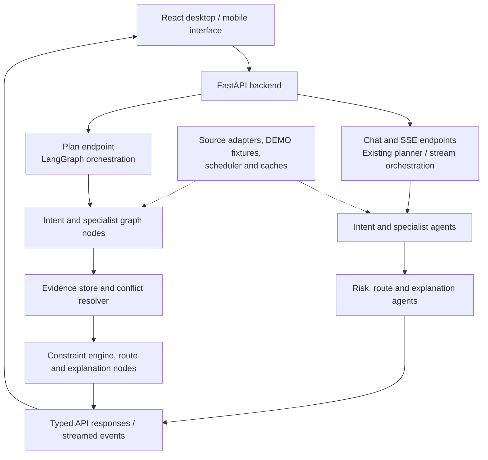

<div align="center">



# MARVO

### Marine Agentic Reasoning and Voyage Optimizer

**From fragmented marine data to an explainable decision at sea.**

[](https://www.sih.gov.in/sih2026PS)
[](https://www.sih.gov.in/sih2026PS)
[](https://github.com/akshatog/MARVO)

**[Deployed prototype](https://marvo-47mz.onrender.com)** · **[Demo video](https://youtu.be/yg2hYYAysRA)** · **[API documentation](https://marvo-47mz.onrender.com/docs)**

</div>

> **Submission scope:** This README presents Team MARINES' proposed solution for SIH 2026. The [current prototype](#current-prototype) section separately identifies implemented, partially integrated, and planned capabilities. The deployed demonstration uses **DEMO** data.

## Contents

- [Problem statement](#problem-statement)
- [Proposed solution](#proposed-solution)
- [Innovation and design principles](#innovation-and-design-principles)
- [Proposed architecture](#proposed-architecture)
- [Data sources and evidence](#data-sources-and-evidence)
- [Stakeholders and expected impact](#stakeholders-and-expected-impact)
- [Current prototype](#current-prototype)
- [Local setup](#local-setup)
- [Implementation roadmap and validation](#implementation-roadmap-and-validation)
- [Repository guide](#repository-guide)
- [Team and references](#team-and-references)

## Problem statement

| Submission detail | Value |
|---|---|
| Problem statement ID | **SIH26176** (PS 176) |
| Official title | **ORCA Marine EcOsystem Reasoning with Collaborative Agents** |
| Organization / department | Indian Space Research Organisation (ISRO) / Department of Space |
| Theme / category | Space Technology / Software |
| Team name / ID | **MARINES / 175766** |
| Institution | KIET Deemed to be University, Ghaziabad |
| Proposed solution name | **MARVO** |

The [official problem statement](https://www.sih.gov.in/sih2026PS) calls for a conversational marine intelligence platform combining collaborative agents, satellite and ocean information, geospatial reasoning, and actionable recommendations for multiple marine stakeholders.

A fisher planning a trip needs to understand weather, waves, potential fishing zones, restrictions, travel time, and return conditions together. A coastal authority needs the same information across a larger area, with its evidence intact.

Our proposal addresses three connected gaps:

1. **Fragmented marine intelligence:** Forecasts, satellite products, fishing advisories, and geographic restrictions arrive through different sources and formats.
2. **Last-mile advisory access:** Technical maps and bulletins need to become understandable guidance for a particular location, trip, and regional language.
3. **A unified decision layer:** A recommendation must connect where to go, when to leave and return, relevant hazards, and applicable official restrictions.

## Proposed solution

MARVO proposes a conversational platform in which **ten specialized agent roles** assemble marine evidence into a location- and time-specific recommendation. Users ask through text or voice; the system gathers relevant information, evaluates constraints, proposes a trip, and explains its basis.

The platform answers: **Where should I go? When should I go? How should I get there and return? What fishing opportunity should I consider? Why is this recommendation appropriate?**

### A proposed user journey

> **Example request:** "I am leaving from Ratnagiri tomorrow morning. Where can I fish for mackerel and return before the sea gets rough?"

1. **Understand.** Identify location, departure time, duration, target species, boat constraints, language, and preferences. Ask follow-up questions when essential details are missing.
2. **Gather.** Retrieve forecasts, ocean conditions, fishing-zone information, advisories, and geographic constraints for the requested area and time window.
3. **Evaluate.** Apply deterministic hazard checks and official advisory constraints before ranking fishing opportunities and candidate routes.
4. **Explain.** Return a recommended zone, departure/return window, route, risk factors, indicative trip economics, and supporting evidence.
5. **Monitor.** Reassess an active trip when evidence changes and, where tracking and communications are available, issue location-specific warnings or diversion guidance.

### Proposed decision outputs

| Output | What the user receives |
|---|---|
| Trip assessment | GO / CAUTION / NO-GO guidance, or insufficient evidence when a reliable assessment cannot be made |
| Fishing opportunity | Ranked zones and indicative species suitability, with the factors behind the ranking |
| Time window | Departure, fishing, and return windows evaluated against forecast validity |
| Fishing calendar | A proposed outlook of up to 10 days, bounded by the actual forecast horizon and data quality |
| Route | Candidate outward/return paths, geographic constraints, and alternatives |
| Trip economics | Indicative fuel, time, cost, and revenue estimates with visible assumptions |
| Evidence and explanation | Source, observation/forecast time, freshness, confidence, advisory constraints, and decision rationale |
| Alerts | Relevant changes in weather, cyclone conditions, restrictions, or projected drift |

Fishing suitability and economic estimates require local calibration; they are not guaranteed catch probabilities or earnings.

The risk score summarizes hazards, evidence confidence describes input quality, and habitat suitability ranks fishing opportunities. These are separate measures and must be presented separately.

## Innovation and design principles

| Proposed differentiator | Design approach |
|---|---|
| **A unified decision layer** | Combine fishing opportunities, timing, route feasibility, and marine risk in one contextual answer, retaining the original evidence. |
| **Collaborative specialist reasoning** | Coordinate weather, ocean, PFZ, cyclone, and GIS roles through structured state. |
| **Deterministic safety constraints** | Keep risk calculations, advisory precedence, geometry, and route costs in inspectable code. Language models support interpretation and explanation. |
| **Pre-departure Drift / SAR Envelope** | Project possible drift positions from current, wind, elapsed time, and vessel assumptions to support preparedness and search-and-rescue planning. **Planned extension.** |
| **IMBL Current Guard** | Estimate drift toward the International Maritime Boundary Line and issue early warnings using authoritative boundaries and current vectors. **Planned extension.** |
| **Regional-language delivery** | Prioritize English, Hindi, and Marathi text and voice, with an extensible language layer and simple mobile interactions. |
| **Evidence transparency** | Expose provenance, validity, conflicts, and LIVE / CACHED / STALE / DEMO / unavailable evidence. |
| **Low-connectivity access** | Provide a PWA with saved trip information and dated cached evidence; expand offshore delivery through approved communications partnerships. |

The proposal uses a habitat-suitability approach to fishing-zone ranking: chlorophyll, sea-surface temperature, thermal fronts, sea state, and time of day contribute to an indicative suitability index. The prototype's coefficients are engineering heuristics; validation against catch records is part of the roadmap.

### Safety contract of the proposed platform

- **Official restrictions take precedence.** A favorable fishing score cannot cancel a valid official no-go advisory or a prohibited area.
- **Safety floors only raise risk.** The intended rule is `final_risk = max(model_risk, applicable_safety_floors)`, with every applied constraint recorded.
- **Missing evidence is explicit.** Missing or expired essential inputs must produce an insufficient-evidence or degraded assessment.
- **Authority and freshness remain visible.** Old or simulated values must not acquire LIVE labels because of the selected runtime mode.
- **Uncertainty is preserved.** Drift envelopes, suitability scores, and trip estimates expose assumptions and limits.

These are design requirements. End-to-end enforcement across the prototype's decision paths is an implementation and validation priority.

## Proposed architecture

### System architecture



Persistent evidence storage, complete offline trip packs, production notifications, and drift/IMBL services are part of the target architecture. The prototype currently uses in-memory stores for several services.

### Collaborative decision workflow



Arrows describe workflow dependencies; agents read and contribute structured state. Evidence storage and conflict resolution are supporting services, not additional agent roles. The Planner is the orchestration role; a language model is optional for understanding and explaining the request.

| Agent role | Proposed responsibility |
|---|---|
| Intent | Extract location, time, activity, language, species, and trip constraints; retain conversation context. |
| Planner | Select specialists/tools, coordinate parallel work, and assemble the decision workflow. |
| Weather | Supply wind, rain, visibility, and atmospheric forecasts. |
| Ocean | Supply waves, swell, currents, SST, and related ocean observations. |
| PFZ | Rank fishing opportunities from official products and habitat-suitability evidence. |
| Cyclone | Interpret warnings with issuing authority, severity, and validity. |
| GIS | Evaluate coastline, ports, restricted areas, and approved maritime boundaries. |
| Risk | Compute deterministic risk factors and enforce advisory constraints. |
| Route | Search paths under risk, geographic, vessel, and return-time constraints. |
| Explanation | Present the result, uncertainty, and evidence in the user's language. |

### Technology choices

| Layer | Prototype foundation and proposed direction |
|---|---|
| Interface | React 18, TypeScript, Vite, Tailwind CSS; desktop/mobile layouts |
| Mapping | Mapbox GL in the current main map; Leaflet also present in the frontend stack |
| Backend and contracts | Python, FastAPI, Pydantic v2, HTTPX |
| Orchestration | LangGraph planning pipeline alongside existing chat/stream orchestrators |
| Decision services | Deterministic hazard model, YAML safety/economics configuration, A* route search |
| Language services | Templates; optional Groq, Cerebras, Gemini, and Sarvam integrations |
| Data refresh and storage | APScheduler and memory/disk caches; persistent evidence/voyage storage planned |
| Delivery | Docker, Render, GitHub Actions; PWA manifest and service worker |

## Data sources and evidence

The proposal combines real-time and historical information where coverage, access, and licensing permit. Listing a source does not imply a formal partnership or complete nationwide integration.

| Source family | Intended contribution | Prototype position |
|---|---|---|
| [Open-Meteo Forecast](https://open-meteo.com/en/docs) and [Marine](https://open-meteo.com/en/docs/marine-weather-api) | Weather, waves, SST, available current forecasts | Adapters and time-series cache implemented; live availability depends on service coverage. |
| [INCOIS](https://incois.gov.in/MarineFisheries/MarineFisheryAdvisory) | Official PFZ and ocean advisories | Bulletin/ERDDAP adapters present; product access and end-to-end coverage need validation. |
| [IMD](https://mausam.imd.gov.in/) and [GDACS](https://www.gdacs.org/) | Official warnings and cyclone/disaster context | Scraper/feed integrations present; advisory propagation and validity need hardening. |
| [ISRO MOSDAC](https://www.mosdac.gov.in/) | Available satellite chlorophyll/SST products | Download/parsing adapters present; product access is credential- and availability-dependent. |
| [NOAA CoastWatch](https://coastwatch.noaa.gov/) | Additional satellite/ocean observations | Fallback adapter paths present; coverage and provenance need validation. |
| [OBIS](https://obis.org/) / [Map of Life](https://mol.org/) | Historical species-occurrence context | Regional snapshot/heuristic context; not a live fish-location feed. |
| [OpenStreetMap](https://www.openstreetmap.org/copyright) and approved GIS datasets | Basemap, ports, coastline, geographic constraints | Port/restricted-zone fixtures and geometry present; authoritative IMBL and operational restrictions remain planned. |

**Proposed evidence policy:** prefer the relevant authoritative source, retain acceptable dated real observations when permitted, and disclose conflicts or gaps. DEMO fixtures remain separate from operational evidence. A cached reading is not automatically current enough for a trip; an overall LIVE setting does not establish that every source is live.

## Stakeholders and expected impact

| Stakeholder | Proposed value |
|---|---|
| Fishers | Understandable trip assessments, regional voice, candidate zones, cost assumptions, and return guidance. |
| Disaster management agencies | Cyclone exposure views, vessels-at-risk analysis, drift/SAR envelopes, and alert coordination. |
| Coastal authorities | Shared risk/evidence views, approved geofence monitoring, advisory dissemination, and auditable decisions. |
| Researchers | Source-traceable queries, historical analysis, conflict inspection, and PFZ validation using catch reports. |
| Maritime operators | Weather-window assessment, route alternatives, and future fleet/voyage monitoring. |

The intended outcomes are better-informed trip choices, fewer avoidable departures into adverse conditions, less unnecessary travel, and faster interpretation of marine evidence. Quantitative impact will be established through pilots; this submission does not claim measured accident reductions, fuel savings, or catch increases.

### Feasibility and deployment strategy

The existing stack provides a working foundation on standard phones and laptops. Public forecast interfaces support initial integration; government products, authoritative boundaries, and offshore communications require appropriate access and validation.

| Challenge | Proposed response |
|---|---|
| Incomplete or delayed feeds | Freshness checks, bounded retries, dated real caches, explicit insufficient-evidence handling. |
| Poor connectivity | Expiry-labeled trip packs, lightweight mobile interactions, later approved satellite/VCSS delivery integrations. |
| Conflicting sources | Authority- and validity-aware resolution with disagreements preserved in evidence. |
| Uncertain fish suitability and drift | Calibration by species, season, region, and vessel against independent observations. |
| Operational scale and access control | Persistent storage, role-based access, rate limits, observability, institution-supported pilots. |

## Current prototype

**Status: submission prototype; checked on 7 October 2026.** The [deployed health endpoint](https://marvo-47mz.onrender.com/api/health) reported `status: ok` and `data_mode: DEMO` during review. The public demo requires no user-provided API keys.



*Actual deployed interface captured in DEMO mode. Measurements and the displayed warning are demonstration data, not an official current advisory.*

| Capability | Current implementation |
|---|---|
| Web and mobile experience | Desktop dashboard, phone-oriented interface, location/harbour selection, maps, and guided tour implemented. |
| Conversational workflow | Chat and SSE progress implemented; planning and trace/state APIs implemented through LangGraph. |
| Risk and route foundation | Configurable deterministic risk/floor logic and A* search implemented; cross-path advisory handling, route constraints, and forecast-time correctness require further validation. |
| Fishing and trip views | Candidate zones, suitability factors, time windows, and indicative economics implemented as prototype heuristics. |
| Evidence and diagnostics | Evidence, conflict, and trace schemas/APIs and UI panels implemented; consistent per-source provenance and integration remain validation priorities. |
| External data | Weather/marine and additional advisory/satellite adapters implemented; DEMO fixtures support demonstrations. |
| Regional language and voice | English, Hindi, and Marathi UI/text pathways present; Sarvam STT/TTS requires a key. Complete language/device coverage is not yet validated. |
| Voyage and alerts | In-memory voyage lifecycle and alert endpoints implemented; durable fleet tracking and production broadcast delivery planned. |
| PWA and offline access | Manifest, service worker, and initial caching implemented; complete offline maps, trip packs, and expiry-aware decisions planned. |
| Drift / SAR and IMBL guard | Proposed; not implemented as validated operational services. |
| Stakeholder platform | Fisher and authority-facing views exist; distinct researcher, disaster-management, and maritime workflows remain planned. |

### Current runtime architecture



The two paths coexist. The current LangGraph has **11 nodes**: intent, five specialists, evidence store, conflict resolver, constraint engine, route, and explanation. Its planner role is graph orchestration rather than a separate planner node. The proposed ten-role architecture and current node count describe different levels of the system.

### Try the demonstration

1. Open the [deployed prototype](https://marvo-47mz.onrender.com) and select **Open the MARVO App** or the guided tour.
2. Keep **DEMO** selected and choose Mumbai, Ratnagiri, or Paradip.
3. Inspect conditions, risk factors, fishing grounds, and restricted-area overlays.
4. Open **Ask MARVO**, ask a location-specific trip question, and inspect agent progress and the explanation.
5. Explore **Authority** and **Ops & Provenance**, or watch the [submission video](https://youtu.be/yg2hYYAysRA).

MARVO is an evaluation prototype, not a certified navigation or emergency-response service. Follow official INCOIS, IMD, and Coast Guard instructions for real operations.

## Local setup

### Prerequisites

- **Python 3.10+**; CI and Docker use Python 3.10.
- **Node.js 20+** and npm.
- **Git**; Docker with Compose is optional.
- Internet for dependencies and map tiles. DEMO mode needs no backend provider keys. The current basemap needs a Mapbox public access token.

### Windows PowerShell

Run these commands on a fresh clone. Use the virtual environment directly; no activation-policy changes are needed.

```powershell
git clone https://github.com/akshatog/MARVO.git
Set-Location MARVO
python -m venv backend/.venv
./backend/.venv/Scripts/python.exe -m pip install --upgrade pip
./backend/.venv/Scripts/python.exe -m pip install -r backend/requirements.txt
Copy-Item backend/.env.example backend/.env
Copy-Item frontend/.env.example frontend/.env.local
```

Set `VITE_MAPBOX_TOKEN` in `frontend/.env.local` to a Mapbox **public** token (`pk...`). Keep server-side API keys in `backend/.env`; Vite variables are included in the browser bundle.

```powershell
Set-Location frontend
npm ci
npm run build
Set-Location ../backend
$env:MARVO_DATA_MODE = "DEMO"
$env:MARVO_USE_LLM = "0"
./.venv/Scripts/python.exe -m uvicorn app.main:app --host 127.0.0.1 --port 8000
```

Open **[http://localhost:8000](http://localhost:8000)**. FastAPI serves the built frontend and API together. API reference: **[http://localhost:8000/docs](http://localhost:8000/docs)**. Health check: **[http://localhost:8000/api/health](http://localhost:8000/api/health)** should show `status: ok` and `data_mode: DEMO`.

### macOS / Linux

```bash
git clone https://github.com/akshatog/MARVO.git
cd MARVO
python3 -m venv backend/.venv
backend/.venv/bin/python -m pip install --upgrade pip
backend/.venv/bin/python -m pip install -r backend/requirements.txt
cp backend/.env.example backend/.env
cp frontend/.env.example frontend/.env.local
# Set VITE_MAPBOX_TOKEN in frontend/.env.local before building.
cd frontend
npm ci
npm run build
cd ../backend
MARVO_DATA_MODE=DEMO MARVO_USE_LLM=0 .venv/bin/python -m uvicorn app.main:app --host 127.0.0.1 --port 8000
```

### Development with hot reload

After installation, run the backend command above with `--reload` in one terminal. In a second terminal, run `npm run dev` from `frontend/` and open **[http://localhost:5173](http://localhost:5173)**. Vite proxies API requests to port 8000.

### Docker demonstration

From the repository root, set the public map token and use the explicit DEMO override:

```powershell
$env:VITE_MAPBOX_TOKEN = "YOUR_MAPBOX_PUBLIC_TOKEN"
docker compose -f docker-compose.yml -f docker-compose.demo.yml up --build marvo
```

On macOS/Linux, replace the first line with `export VITE_MAPBOX_TOKEN="YOUR_MAPBOX_PUBLIC_TOKEN"`. Open port 8000; stop with `docker compose -f docker-compose.yml -f docker-compose.demo.yml down`.

### Optional live data and language services

| Configuration | Purpose |
|---|---|
| `MARVO_DATA_MODE=DEMO` / `LIVE` | Select fixtures or attempt live adapters; availability depends on source coverage/access. |
| `MARVO_USE_LLM=0` / `1` | Controls the legacy optional LLM layer. To avoid provider calls across all paths, also leave all LLM keys empty. |
| `GROQ_API_KEY`, `CEREBRAS_API_KEY`, `GEMINI_API_KEY` | Optional language-model providers; templates are available without credentials. |
| `SARVAM_API_KEY` | Optional speech transcription, synthesis, and translation. |
| `MOSDAC_USER`, `MOSDAC_PASS`, `MARVO_MOSDAC_ENABLED` | Optional MOSDAC credentials/activation; some scheduled requests also depend on credential presence. |
| `VITE_MAPBOX_TOKEN` | Public frontend map token; configure before building. |

Start with the blank-key templates. Add credentials only for the integration being evaluated. Restart the backend after changing its environment; rebuild the frontend after changing a `VITE_` variable. LIVE mode does not certify every result as current operational evidence. Background refresh jobs can still attempt network access in DEMO mode.

### Troubleshooting

| Symptom | Check |
|---|---|
| Port 8000 shows API information instead of the app | Build the frontend, then restart FastAPI. |
| Blank map or token errors | Set a valid public Mapbox token, check URL restrictions, and rebuild/restart Vite. |
| Vite API/network errors | Keep the backend running on port 8000. |
| An older interface persists | Clear the site's service worker/cache, then reload the app. |
| Voice or AI provider features unavailable | Check optional server-side keys; ordinary DEMO assessments do not require them. |

## Implementation roadmap and validation

| Milestone | Work to complete | Evidence of completion |
|---|---|---|
| **1. Decision correctness** | Preserve official warnings across chat, plan, and alerts; enforce evidence sufficiency; normalize units; honor trip times; correct fallback provenance. | Contract/failure tests show consistent verdicts, no synthetic LIVE values, and no GO from missing critical evidence. |
| **2. Operational trip planning** | Validate outward/return routes against land, approved restrictions, currents, vessel limits, and changing forecasts. | Independently checked coastal scenarios and explicit no-route handling. |
| **3. Scientific calibration** | Evaluate suitability, species relevance, and economics against regional observations and catch/trip records. | Dataset provenance, reproducible baselines, calibration results, and uncertainty reporting. |
| **4. Proactive safety** | Implement drift/SAR envelopes and IMBL guard using authoritative geometry and validated assumptions. | Boundary, drift, and alert-delivery scenarios reviewed with domain stakeholders. |
| **5. Durable access** | Add persistent stores, access controls, alert delivery, complete offline trip packs, and broader language testing. | Multi-user, restart-recovery, offline-expiry, mobile, and voice evaluation. |
| **6. Coastal pilot** | Pilot with fishers/authorities; expand stakeholder views and approved offshore delivery channels. | Usability feedback, operational review, and measured outcomes against a baseline. |

The main branch includes backend tests, a frontend production build, and a CI health smoke check. TypeScript can also be checked locally. These support implementation quality; they do not establish real-world marine safety or catch effectiveness.

For a fresh, blank-key setup, run backend checks from `backend/`:

```powershell
./.venv/Scripts/python.exe -m pip install pytest
$env:MARVO_DATA_MODE = "DEMO"
$env:MARVO_USE_LLM = "0"
./.venv/Scripts/python.exe -m pytest tests/ -q
```

On macOS/Linux use `.venv/bin/python` and the environment syntax shown earlier. Run frontend checks from `frontend/`:

```bash
npx tsc --noEmit
npm run build
```

## Repository guide

```text
MARVO/
├── README.md                  # Proposal, prototype status and setup
├── .github/workflows/ci.yml   # Backend/frontend and health checks
├── Dockerfile                 # Frontend build, then FastAPI serving
├── docker-compose.yml        # Base container configuration
├── docker-compose.demo.yml   # Blank-key DEMO override
├── render.yaml                # Render deployment configuration
├── backend/
│   ├── .env.example          # Server configuration, no credentials
│   ├── requirements.txt
│   ├── config/               # Risk thresholds and economics YAML
│   ├── app/
│   │   ├── agents/           # Specialists and existing planner
│   │   ├── graph/            # LangGraph topology, nodes and state
│   │   ├── api/              # Chat, plan, voyage, voice and data routes
│   │   ├── data/             # Adapters, fixtures, scheduler and stores
│   │   ├── services/         # Risk, routes, fishing, conflicts, language
│   │   ├── schemas.py        # Typed contracts
│   │   └── main.py           # FastAPI and frontend serving
│   └── tests/
├── frontend/
│   ├── .env.example          # Public frontend configuration
│   ├── src/components/      # Current desktop/mobile interfaces
│   └── public/              # PWA manifest, icons and service worker
└── docs/
    ├── images/              # Branding and labeled screenshots
    └── 00–05 documents      # Design references
```

Design references: [overview](docs/00_overview.md), [architecture](docs/01_architecture.md), [schemas](docs/02_schemas.md), [data sources](docs/03_data_sources.md), [risk/economics](docs/04_risk_and_economics_config.md), and [API contracts](docs/05_api_contracts.md). These describe the evolving design; the current prototype section and generated API reference describe implemented behavior.

Build output, virtual environments, credentials, caches, and local review artifacts stay outside version control. The reference presentation is retained at the repository root. It uses earlier ORCA solution branding; this README uses **MARVO** for the team's solution and **ORCA** for the official problem statement.

## Team and references

**Team MARINES · Team ID 175766 · KIET Deemed to be University, Ghaziabad**

| Member | Team role |
|---|---|
| Nitish Sablok | Team Leader |
| Akshat Agarwal | Backend & AI |
| Tanya Vaish | Frontend & UI/UX |
| Samveg Jain | Product & Demo |
| Muskan Singh | Research & Documentation |
| Deepak | QA & DevOps |

Proposal reference: [Team MARINES presentation](<Problem Statement ID – 176 Problem Statement Title- S Theme- PS Category- Software Team ID- Team Name (Registered on portal)  MARINES (2).pdf>). This is the available submission reference, not necessarily the latest slide revision.

Background/data references: [SIH problem statements](https://www.sih.gov.in/sih2026PS), [INCOIS advisories](https://incois.gov.in/MarineFisheries/MarineFisheryAdvisory), [IMD](https://mausam.imd.gov.in/), [Open-Meteo Marine](https://open-meteo.com/en/docs/marine-weather-api), [ISRO MOSDAC](https://www.mosdac.gov.in/), [GDACS](https://www.gdacs.org/), [OBIS](https://obis.org/), and [OpenStreetMap attribution](https://www.openstreetmap.org/copyright).

**Safer trip decisions, clearer evidence, and accessible marine intelligence.**
